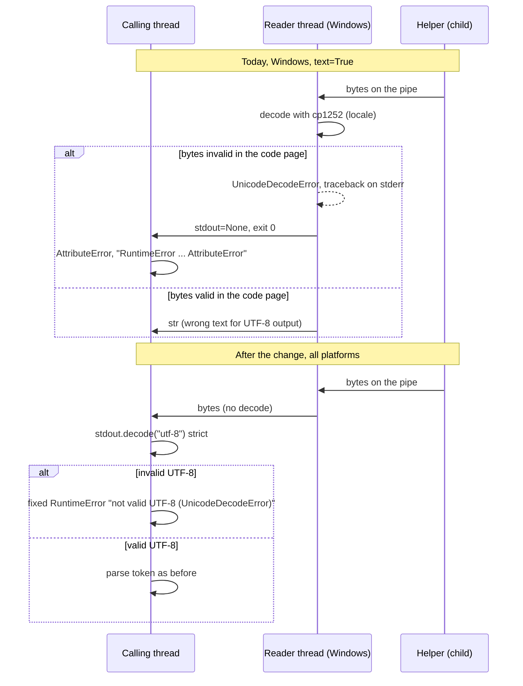

# Credentials helper output: strict UTF-8, decoded in the calling thread (ROMAIN-70)

Status: draft. Scope: `_run_credentials_helper` in `src/airedale/gateway.py`, its tests, one `README.md` line.
Decision (Romain, option A): helper output is strict UTF-8 on all platforms.

## Problem

`_run_credentials_helper` calls `subprocess.run(command, shell=True, capture_output=True, text=True, ...)`
with no `encoding`. On Windows this has two effects:

1. `subprocess` decodes with the locale code page (`cp1252` on the runners), not UTF-8. Non-ASCII UTF-8
   output is decoded wrong, with no error.
2. On Windows, `communicate()` decodes each pipe in a reader thread (`Popen._readerthread`). A decode error
   stops that thread and goes to `threading.excepthook` (a traceback on stderr). `subprocess.run` returns
   `stdout=None` with exit code 0. `result.stdout.strip()` then raises `AttributeError`, and the
   `RuntimeError` names `AttributeError`, not a decode error.

`encoding="utf-8"` alone fixes effect 1 only: invalid UTF-8 still fails in the reader thread.

## What the code does today

- `stdout`: the only use is `result.stdout.strip()`, then `split("\n")`, `line.strip()`, a JWT regex, and
  "last non-empty line". Callers of the function: `resolve_provider_config` (one call site) and tests.
- `stderr`: **never read**. It is captured only so it does not go to the terminal. `CalledProcessError.stderr`
  holds it, and the code uses only `e.returncode`. A comment says: never log or raise it (it can hold a credential).
- Errors: the function collects a fixed `failure` text inside the `except` blocks, leaves the loop, and raises
  `RuntimeError(failure)` **outside** every handler. So `__cause__` and `__context__` are `None`, and the
  message has no command, no output and no secret. `exception_summary` gives only type names and a file:line.

## Approach

1. Remove `text=True`. `subprocess.run` returns `bytes` for `stdout` and `stderr`. No decode runs in a reader
   thread, on any platform.
2. In the calling thread, inside the existing `try`: `output = result.stdout.decode("utf-8").strip()`.
   (Strict: `errors="strict"`. No `replace`, no `ignore`: a changed byte in a token must not pass silently.)
3. Add one handler, `except UnicodeDecodeError`. It sets a fixed `failure` text and `break`s (the same shape as
   the timeout handler: a decode error is deterministic, so no retry):
   `"Credentials helper output is not valid UTF-8 (UnicodeDecodeError). Make the helper write UTF-8."`
   The text has no byte of the output. (`str(UnicodeDecodeError)` has the byte value and position, but we
   do not use it.) The handler raises nothing, so the raise stays outside the handlers.
4. **`stderr` is never decoded.** It stays as bytes in `CalledProcessError.stderr` and nothing reads it.
   This removes the second reader-thread decode (stderr) too. If a future change must show stderr, it must use
   `errors="replace"` (a bad byte must not hide the real failure) and must not log it, because of the secret rule.
   Not chosen: `stderr=subprocess.DEVNULL`. It would keep a secret out of memory, but it changes the pipe the
   helper sees, and this is not needed for the fix.
5. Newlines: `text=True` also turned `\r\n` into `\n`. Bytes do not. The existing `line.strip()` removes the `\r`,
   so the result is the same. A test pins this (AC 4).
6. `README.md`: in the credentials section, say that helper output must be UTF-8.

## Constraints

- Same behavior on Linux, macOS and Windows: the same bytes give the same token or the same error.
- Behavior change on Windows (accepted by Romain): a helper that prints non-ASCII `cp1252` (or OEM code page)
  text now fails with the decode error. A helper that prints ASCII only is not affected (ASCII is valid UTF-8).
  A UTF-8 BOM is **not** removed with `"utf-8"` (see Open points).
- No secret in any error, log or traceback; `__cause__` and `__context__` stay `None`; no thread traceback.
- No new dependency. Only the standard library.
- The timeout (30 s), the retry on non-zero exit, and the 30-minute cache do not change.

## Interaction with ROMAIN-66 (PR #69, same test)

PR #69 changes `test_invalid_utf8_output_of_a_real_helper_does_not_leak_through_the_context` (helper with byte
`0x81`, precondition, `threading.excepthook` capture). It has three rules that exist **only** because Windows
decodes in a thread: do not assert the error type; do not count thread exceptions; capture `excepthook`.
After this change, these can be stricter in the same test:

- `pytest.raises(RuntimeError, match="UnicodeDecodeError")` (the type is the same on all platforms).
- `assert thread_errors == []` (no thread exception on any platform). The `excepthook` capture stays, so a
  regression fails the test and not the pytest warning filter.
- The precondition can drop `locale.getpreferredencoding(False)`: only UTF-8 matters now. `0x81` stays valid as
  the bad byte.

**Merge order: #69 first, then this PR.** #69 has no production change and turns `test-windows` green for this
test today. This PR then rebases on `main` and tightens the same test. The other order would make #69 conflict
on the same lines and make its precondition and its three rules obsolete. If #69 is not merged when the
Implementer starts, stack on #69's branch.

## Other `subprocess` calls with `text=True` in `src/` (listed only, not changed)

All three run `git`, with no `encoding`, so on Windows they use the locale code page:

- `src/airedale/workdir.py:251` (`_run_git_sync`)
- `src/airedale/skills.py:99` (`git rev-parse --git-path info/exclude`)
- `src/airedale/config/experiment.py:291` (`git rev-parse --show-toplevel`)

The `asyncio.subprocess` calls (`pi.py`, `mcp.py`, `workdir.py:238`) use bytes already. Not in scope.

## Open points (for the Adversarial Reviewer)

1. **UTF-8 BOM.** Windows PowerShell can write a BOM. With `"utf-8"` the BOM stays in the first line, and
   `str.strip()` does not remove it, so the token is wrong with no error. `"utf-8-sig"` is still strict UTF-8
   and removes a BOM. Proposed default: keep `"utf-8"` (the decision as written); decide in review.
2. **Test mocks.** 5 existing tests mock `subprocess.run` with `stdout="..."` (str). They must change to
   bytes. The `"decode"` case of `test_command_of_the_helper_is_not_logged_or_raised` must return invalid bytes
   from the mock, because `subprocess.run` no longer raises `UnicodeDecodeError`.

## Acceptance criteria

1. `[unit test]` `_run_credentials_helper` calls `subprocess.run` without `text=True` and without `encoding`
   (assert on the mock call), and the token is decoded from bytes.
2. `[unit test]` Valid non-ASCII UTF-8 output (for example `"tökén-é\n".encode()`) gives the same token on all
   platforms.
3. `[unit test]` Invalid UTF-8 output (mock and a real helper with `sys.executable`) raises `RuntimeError` whose
   message has `UnicodeDecodeError`; `__cause__` and `__context__` are `None`; the secret is not in `repr`, the
   formatted traceback or the log; no exception reaches `threading.excepthook`; no retry (1 call).
4. `[unit test]` `b"line\r\ntoken\r\n"` and a JWT line with `\r\n` give the same token as with `\n`.
5. `[unit test]` The ROMAIN-66 test passes, with the stricter assertions of the section above.
6. `[CI]` The Linux and macOS jobs pass.
7. `[CI]` The `test-windows` job passes for the tests of AC 2 to 5 (read the job and the test names. The job has
   `continue-on-error: true`, so a green check alone is not proof).
8. `[docs]` `README.md` says that helper output must be UTF-8, and that a non-UTF-8 helper now fails with a decode
   error.
9. `[review]` The diff has no `text=True`, no `errors="replace"`/`"ignore"` for `stdout`, no new dependency, and
   no change to the three `git` calls above.
10. `[review]` The Adversarial Reviewer gives a decision on the BOM (Open point 1).

## Review requirements

Classification: **risky** (credential handling, a security boundary, a behavior change on Windows).

- The **Reviewer** checks each acceptance criterion and records pass or fail for each.
- The **Adversarial Reviewer** tries to break the change: a secret in an error, log, traceback or `__context__`;
  a decode error that still goes to a thread; a platform that decodes differently; a BOM or `\r` case; a
  retry or cache that keeps a bad value.

## Estimate

About 1.5 hours: 20 minutes for the code and the README, 40 minutes for the tests (mocks to bytes, new cases,
the ROMAIN-66 test), 30 minutes to read the CI results. The merge of #69 is not included.
