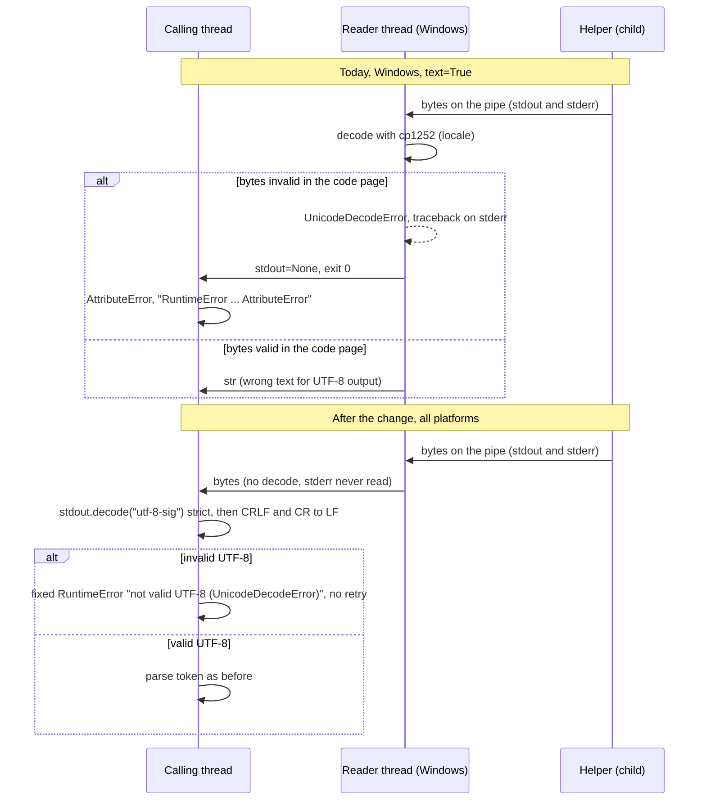

# Credentials helper output: strict UTF-8, decoded in the calling thread (ROMAIN-70)

Status: draft, version 3 (after challenge round 2 and planning). Scope: `_run_credentials_helper` in
`src/airedale/gateway.py`, its tests, one `README.md` line.
Decision (Romain, option A): helper output is strict UTF-8 on all platforms.

## Problem

`_run_credentials_helper` calls `subprocess.run(command, shell=True, capture_output=True, text=True, ...)`
with no `encoding`. On Windows this has two effects:

1. `subprocess` decodes with the locale code page (`cp1252` on the runners), not UTF-8. Non-ASCII UTF-8
   output is decoded wrong, with no error.
2. On Windows, `communicate()` decodes each pipe in a reader thread (`Popen._readerthread`). A decode error
   stops that thread and goes to `threading.excepthook` (a traceback on stderr). `subprocess.run` returns
   `stdout=None` with exit code 0. `result.stdout.strip()` then raises `AttributeError`, and the
   `RuntimeError` names `AttributeError`, not a decode error.

`encoding="utf-8"` alone fixes effect 1 only: invalid UTF-8 still fails in the reader thread.

## What the code does today

- `stdout`: used only as `result.stdout.strip()`, then `split("\n")`, `line.strip()`, a JWT regex, and
  "last non-empty line". Callers: `resolve_provider_config` (one call site) and tests.
- `stderr`: Airedale never inspects it. `communicate()` drains both pipes, and with `text=True` it also decodes
  both. `CalledProcessError.stderr` holds it, but the code uses only `e.returncode`. A comment says: never log or
  raise it (it can hold a credential).
- Newlines: `text=True` uses universal newlines. It turns `\r\n` **and a lone `\r`** into `\n`.
- Errors: the function collects a fixed `failure` text inside the `except` blocks, leaves the loop, and raises
  `RuntimeError(failure)` **outside** every handler. So `__cause__` and `__context__` are `None`, and the
  message has no command, no output and no secret. The caller logs the provider and `exception_summary`
  (type names and file:line), not `exc_info`.

## Approach

1. Remove `text=True`. `subprocess.run` returns `bytes` for `stdout` and `stderr`. No decode runs in a reader
   thread, on any platform.
2. In the calling thread, inside the existing `try`, decode `stdout` with `"utf-8-sig"` (strict). Then
   normalize the newlines by hand, to give the same lines as universal newlines:
   `output = raw.decode("utf-8-sig").replace("\r\n", "\n").replace("\r", "\n").strip()`.
   The order matters: CRLF first, then a lone CR. Nothing else in the parser changes.
   - `utf-8-sig` is strict UTF-8 plus: it removes **one** leading BOM (`EF BB BF`) if present. It does not accept
     malformed UTF-8. No `errors="replace"` or `"ignore"`: a changed byte in a token must not pass silently.
   - Why accept a BOM: Windows PowerShell can write one. With plain `"utf-8"` the BOM (U+FEFF) stays on the first
     token, `str.strip()` does not remove it, and it can defeat the JWT preference with no error.
     The BOM is optional and is documented in the README.
3. Add one handler, `except UnicodeDecodeError`. It sets a fixed `failure` text and `break`s (the same shape as
   the timeout handler: a decode error is deterministic, so no retry):
   `"Credentials helper output is not valid UTF-8 (UnicodeDecodeError). Make the helper write UTF-8."`
   The text has no byte of the output. The handler raises nothing, so the raise stays outside the handlers.
4. **Airedale never inspects `stderr`.** It stays as bytes in `CalledProcessError.stderr`, and nothing reads,
   decodes, logs or shows it. This removes the second reader-thread decode too, so invalid stderr bytes on a
   successful helper cannot cause a thread exception. If a future change must show `stderr`, it needs its own
   review: `errors="replace"` makes the text safe to print, but it is **not** redaction.
   Not chosen: `stderr=subprocess.DEVNULL`. It would keep a secret out of memory, but it changes the pipe the
   helper sees, and the fix does not need it.
5. Traceback guarantee: no secret appears in a **normally formatted** traceback or exception chain
   (`traceback.format_exception`, the default hook). It does not cover a reporter that prints frame locals: such a
   tool can show `result` (the raw bytes) and `command`. This limit was true before this change, and it is stated
   here so nobody reads the guarantee as wider.
6. No `str` fallback in production code. `_run_credentials_helper` accepts bytes from `subprocess.run` only.
7. `README.md`: in the credentials section, say that helper output must be UTF-8 (one optional BOM is accepted),
   and that a non-UTF-8 helper fails with a decode error.

## Constraints

- Same behavior on Linux, macOS and Windows: the same bytes give the same token or the same error.
- Behavior change on Windows (accepted by Romain): a helper that prints non-ASCII `cp1252` (or OEM code page)
  text now fails with the decode error. A helper that prints ASCII only is not affected (ASCII is valid UTF-8).
- Line endings: `\n`, `\r\n` and a lone `\r` give the same lines as before the change.
- No secret in any error, log or normally formatted traceback; `__cause__` and `__context__` stay `None`; no
  thread traceback.
- No new dependency. Only the standard library.
- The timeout (30 s), the retry on non-zero exit, and the 30-minute cache do not change.

## Interaction with ROMAIN-66 (PR #69, same test)

PR #69 changes `test_invalid_utf8_output_of_a_real_helper_does_not_leak_through_the_context` (real helper with
byte `0x81`, precondition, `threading.excepthook` capture). It has three rules that exist only because Windows
decodes in a thread: do not assert the error type; do not count thread exceptions; capture `excepthook`.
After this change, these can be stricter in the same test:

- `pytest.raises(RuntimeError, match="is not valid UTF-8")` (the fixed text, the same on all platforms). Do not
  match only `UnicodeDecodeError`: the code of today already puts that type name in the message on Linux and
  macOS (`exception_summary`), so that match cannot fail there.
- `assert thread_errors == []` (no thread exception on any platform). The `excepthook` capture stays.
- The precondition can drop `locale.getpreferredencoding(False)`: only UTF-8 matters now.

**Keep #69's helper (`sys.executable`, byte `0x81`) and `thread_errors == []`.** But `0x81` is invalid in UTF-8
**and** in `cp1252`, so it cannot tell strict UTF-8 from "UTF-8, then `cp1252` fallback". The real-helper tests
below (AC 3 to 5) close this gap.

**Merge order: #69 first, then this PR.** #69 has no production change and turns `test-windows` green for this
test today. This PR then merges `main` into its branch (a merge commit, no rebase: pushed commits are
immutable) and tightens the same test. The other order would make #69 conflict on the same lines. If #69 is not
merged when the Implementer starts, merge #69's branch into this branch, and merge `main` again after #69 is
merged. This PR is not merged before #69.

The `test-windows` job is on `main` since PR #64 (merged). This branch already contains it.

## Other `subprocess` calls with `text=True` in `src/` (listed only, not changed)

All three run `git`, with no `encoding`, so on Windows they use the locale code page:

- `src/airedale/workdir.py:251` (`_run_git_sync`)
- `src/airedale/skills.py:99` (`git rev-parse --git-path info/exclude`)
- `src/airedale/config/experiment.py:291` (`git rev-parse --show-toplevel`)

The `asyncio.subprocess` calls (`pi.py`, `mcp.py`, `workdir.py:238`) use bytes already. Not in scope.

## Test changes

- Six `str` stdout mocks in `tests/test_gateway.py` (lines 82, 92, 98, 104, 190, 213) become `bytes`
  (for example `stdout=b"raw-token-123\n"`).
- Two decode-error mocks stop raising `UnicodeDecodeError` from `subprocess.run` (it no longer raises it) and
  return `MagicMock(stdout=b"\xff" + secret.encode(), returncode=0)` instead:
  `tests/test_gateway.py:148` (the `"decode"` case) and `tests/test_decisions_integration.py:296`.
- Real-helper tests use `sys.executable` (as #69 does), never `printf`. A helper writes raw bytes with
  `sys.stdout.buffer.write(...)` and, for the stderr case, `sys.stderr.buffer.write(...)`.

## Acceptance criteria

1. `[unit test]` `_run_credentials_helper` calls `subprocess.run` without `text`, `universal_newlines` (an alias
   of `text`), `encoding` and `errors` (assert on the mock call). The six `str` mocks and the two decode-error
   mocks are changed as above.
2. `[unit test]` Mocked valid non-ASCII UTF-8 output (`"tökén-é\n".encode()`) gives the same token on all
   platforms.
3. `[unit test]` Real helpers, strict UTF-8 versus a locale fallback (run on all platforms):
   a. bytes `C3 A9` give exactly the token `é`;
   b. a lone byte `E9` (valid `cp1252`, invalid UTF-8) raises `RuntimeError` with the fixed decode text, one
      `subprocess.run` call (no retry), `__cause__` and `__context__` are `None`;
   c. #69's helper (`0x81` + secret) raises the same fixed text, the secret is not in `repr`, the formatted
      traceback or the log, and `thread_errors == []`.
4. `[unit test]` Line endings and BOM, with mocked bytes:
   a. `b"line\r\ntoken\r\n"` gives `token`;
   b. `b"info\rtoken\r"` gives `token` (a lone CR is a line end, as with `text=True`);
   c. `b"\xef\xbb\xbfaaaa.bbbb.cccc\r\nok\r\n"` gives `aaaa.bbbb.cccc` (the BOM is directly before the JWT, then a
      status line). With plain `"utf-8"` the first line keeps U+FEFF, is not a JWT, and the result is `ok`, so
      this case fails if the BOM is not removed;
   d. a BOM before a plain token gives the token without U+FEFF.
5. `[unit test]` Real helper, success with invalid stderr: stdout is a valid token, stderr is `0x81` + a marker
   string. The call returns the token, `thread_errors == []`, and the marker is not in the log (`caplog`) and not
   on the parent's stderr (`capfd`).
6. `[unit test]` The ROMAIN-66 test passes with the stricter assertions of the section above.
7. `[CI]` The Linux jobs pass.
8. `[review]` macOS: a recorded local run of `uv run pytest tests/test_gateway.py tests/test_decisions_integration.py -v`
   (the output in the PR description). There is no macOS job in `ci.yml`.
9. `[CI]` The `test-windows` job (`continue-on-error: true`, so a green check alone is not proof) shows these as
   **passed, not skipped**: the tests of AC 2 to 6, by name (the `PASSED <test id>` lines of `pytest -rfEsp` in
   the job log). The job log also records the **parent** interpreter encoding: `locale.getpreferredencoding(False)`
   and `sys.flags.utf8_mode` in the pytest report header (a `pytest_report_header` hook in `tests/conftest.py`,
   shown with no `-s`). This shows that the Windows run is not in UTF-8 mode, so AC 3b is a real test.
10. `[docs]` `README.md` says that helper output must be UTF-8 (one optional BOM is accepted) and that a
    non-UTF-8 helper fails with a decode error.
11. `[review]` The diff has no `text=True` or `universal_newlines=True`, no `errors="replace"`/`"ignore"` for
    `stdout`, no `str` fallback, no new dependency, and no change to the three `git` calls above.

## Review requirements

Classification: **risky** (credential handling, a security boundary, a behavior change on Windows).

- The **Reviewer** checks each acceptance criterion and records pass or fail for each.
- The **Adversarial Reviewer** tries to break the change: a secret in an error, log, traceback or `__context__`;
  a decode error that still goes to a thread; a platform that decodes differently; a locale fallback that passes
  the tests; a BOM or `\r` case; a retry or cache that keeps a bad value.

## Estimate

About 2 hours: 25 minutes for the code and the README, 60 minutes for the tests (eight mock changes, the new
real-helper tests, the ROMAIN-66 test), 35 minutes to read the macOS and Windows results. The merge of #69 is
not included.
