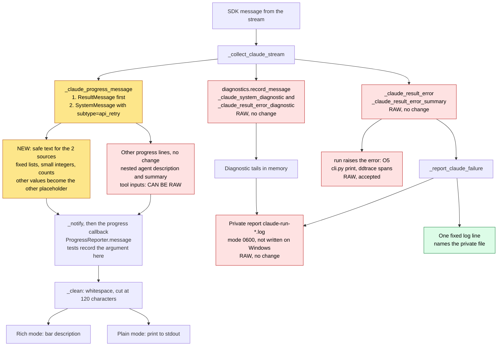

# Safe progress text for failed Claude runs (DD-64, O6)

## Design (v2)

**Decision in one line:** the progress line of a failed Claude run uses a new, progress-only text for 2 sources: an error `ResultMessage` and an `api_retry` system message. This text shows only values from fixed lists, small integers and counts. Any other value shows as `<other>`. The raised error (O5) and the private report keep the current raw functions, with no change.

### Changes from v1

| # | Change | Answers |
|---|---|---|
| 1 | Every end-to-end test records each callback argument **before** it goes to the plain reporter. It asserts the full list of arguments by equality and asserts that each marker is absent from **all** arguments. The stdout and stderr asserts stay (AC1, AC2, AC4). | Blocking 1 |
| 2 | New end-to-end test with a result that has marked `permission_denials` and `deferred_tool_use` inputs. On base, these markers are after character 120 of the line, so only the callback assert can find them (AC5). | Blocking 1 |
| 3 | AC6 is split by rule (AC6a to AC6g). Each expected result agrees with section 3.1. For example, `errors="marker"` gives `errors=1`, and a complete `{id, name, input}` deferred call goes through the SDK parser. | Blocking 2 |
| 4 | AC7 (red on base) applies only to the 2 DD-35 paths and to the retry leak. Each proof uses a marker and an entry point that exists on base. The O5 control, the report control and the valid-format controls do not need to fail on base. | Blocking 2 |
| 5 | The `stop_reason` list has 2 more values: `tool_deferred` and `tool_deferred_unavailable` (now 10 values). | Non-blocking |
| 6 | Dispatch: the progress function handles `ResultMessage` first. The retry line is only for a `SystemMessage` with `subtype == "api_retry"` (AC6g). | Non-blocking |
| 7 | The privacy claim is limited to the 2 sources. Section 1.4 lists the remaining raw paths (nested agent `summary`, tool inputs, O5). The private report keeps today's diagnostic text, not the whole retry object. | Non-blocking |
| 8 | Base: the red-test baseline stays `8e914616`. The draft PR stacks on PR #64 head `5f10db8f`. | Base |

### Code base

- PR [DataDog/airedale#64](https://github.com/DataDog/airedale/pull/64), branch `romain.marcadier/dd-35-pr51-follow-ups`. It is still open.
- **Red-test baseline:** `8e914616`. The line numbers in this document are for this commit.
- **Stack base:** PR #64 head `5f10db8f`. I compared it with `8e914616`. It adds 3 commits (the Decisions grader #56, a dev dependency bump #67, a merge of `main`). These commits do not change `src/airedale/harness/claude.py`, `src/airedale/progress.py` or `tests/test_harness_claude.py`. In `uv.lock`, only `pytest-asyncio` and `ruff` change. `claude-agent-sdk` stays 0.2.179.
- Pinned SDK: `claude-agent-sdk` 0.2.179, with its bundled Claude Code CLI 2.1.319.

---

### 1. Problem and scope

#### 1.1 Problem

When a Claude run fails, the progress and console output (O6) show raw text from the provider and from the CLI. The rich progress bar shows it as the task description. Plain mode prints it to stdout. This text can contain credentials (DD-35 used `sk-…` markers to prove it).

There are 2 sources. I reproduced both on `8e914616`.

| # | Source | Function that builds the progress text | Raw parts in the progress text today |
|---|---|---|---|
| 1 | Error `ResultMessage` (`is_error=True`) | `_claude_progress_message` calls `_claude_result_error_diagnostic`, which calls `_claude_result_error_summary` | the `errors` text; the JSON of `permission_denials` (it has `tool_input`) and of `deferred_tool_use` (it has `input`); `subtype` and `stop_reason` with no check |
| 2 | `SystemMessage` with `subtype="api_retry"` | `_claude_progress_message` calls `_claude_system_diagnostic` | `data.error` when it is a string; `error.type`, `error.error` (a nested object shows as its Python repr) or `error.message` when it is an object; `error_status`, `attempt`, `max_retries` and `retry_delay_ms` with no type check |

Callback arguments today (from runs on `8e914616`; each message went through the real SDK parser):

```text
anthropic/claude-3-haiku-20240307: Claude error result - sk-RESULT-MARKER; subtype=error_during_execution; turns=1
anthropic/claude-3-haiku-20240307: api_retry status=529 error=sk-API-RETRY-MARKER attempt=1/10 retry_delay_ms=500
anthropic/claude-3-haiku-20240307: api_retry status=529 error={'type': 'x', 'message': 'sk-RETRY-MARKER'} attempt=1/10 retry_delay_ms=500
anthropic/claude-3-haiku-20240307: Claude error result - sk-RESULT-MARKER; subtype=error_during_execution; turns=1; permission_denials=[{"tool_name":"Bash","tool_use_id":"t1","tool_input":{"command":"echo sk-DENIAL-MARKER"}}]; deferred_tool_use={"id":"d1","name":"Bash","input":{"command":"echo sk-DEFERRED-MARKER"}}
```

In the last line, `sk-DENIAL-MARKER` starts at character 205 and `sk-DEFERRED-MARKER` at character 295.

The text goes through `_notify` to `ProgressReporter.message`. `_clean` (`progress.py:44-47`) only collapses whitespace and cuts the text at 120 characters. Then the text goes to the rich bar description, or to `print` in `_plain`. **Because of this cut, a console assert cannot see a marker after character 120.** The tests must assert on the callback arguments.

#### 1.2 In scope

- Source 1 and source 2, only where they reach the progress callback (O6).
- The `AGENTS.md` text that lists O6 as an "accepted raw output".

#### 1.3 Out of scope (no change)

| Output | Why it does not change |
|---|---|
| **O5**: the raised error (`run_result.error`), the `cli.py` error print, the ddtrace experiment span and status, the native ddtrace Claude spans | Romain accepted O5 as raw for DD-35. O5 uses `_claude_result_error_summary` (`claude.py:722-726`). This design does not edit that function. A change to O5 needs a separate decision. |
| **O7**: the ddtrace retry summary | DD-65 tracks it. |
| **The private report** (`claude-run-*.log`) | This design does not edit `_claude_system_diagnostic`, `_claude_result_error_diagnostic`, `_ClaudeEvalDiagnostics` or `_write_claude_private_report`. The diagnostics read the SDK message with these raw functions (`claude.py:360-363`), and the progress code does not change the message. |
| `ProgressReporter` and `_clean` (`progress.py`) | The fix is in the Claude harness, before the callback. |
| Other Claude progress lines (section 1.4) | They are other messages, not a path around the 2 new functions. |
| pi and Codex progress lines | Not part of this issue. |

#### 1.4 Remaining risk (what this issue does NOT make safe)

**This issue does not make all console text of a failed run safe.** After this issue, only the 2 sources above give no raw text to the progress callback. These paths can still show raw text:

| Path | Where (on `8e914616`) | What it can show |
|---|---|---|
| Nested agent lines (`TaskStartedMessage`, `TaskProgressMessage`, `TaskNotificationMessage`) | `claude.py:787-804` | the `description` and the `summary` of a nested agent. The CLI type of `summary` is any string. A failed nested agent can have error text there. I did not check this case. |
| Tool call lines (`calling <tool> - <argument>`) | `claude.py:806-811` and `_tool_input_summary` | the first tool input argument (for example a `command`, a `url` or a `prompt`) |
| O5 | `cli.py` error print, ddtrace spans | the raw error summary (accepted for DD-35) |

If Romain wants these paths fixed, each one needs a separate issue.

The private report keeps **today's diagnostic text**, not the whole retry object. For an `api_retry` object, `_claude_system_diagnostic` selects `type`, then `error`, then `message` (`claude.py:700-704`), and `_bounded_claude_diagnostic_value` cuts each value at 1,000 characters (`claude.py:429-433`). For example, for `{"type": "x", "message": "sk-…"}`, the report has `error=x` and not the marker. This issue keeps that behavior.

---

### 2. Approach

#### 2.1 Options

| | Option | How it works | Good | Bad |
|---|---|---|---|---|
| **A** | **Progress-only allow-list in `claude.py`** (recommended) | New functions build the progress text for the 2 sources. They read only the fields in section 3. Each value must be in a fixed list, or be a small integer, or be a count that Airedale computes. Any other value shows as `<other>`. `_claude_progress_message` calls these functions. The raw functions keep their other callers (O5 and the private report). | An unknown value can never be shown: the default is `<other>`. Only O6 changes. O5 and the report use code that does not change. Same rule and same placeholder as the pi harness (`known_value`, `OTHER_VALUE` in `pi_spans.py`). Keeps useful triage data. Small change, no dependency. | The lists can become old after an SDK bump. Then a new valid value shows as `<other>` (less data, but no exposure). |
| B | Generic redaction in `ProgressReporter` | A deny-list of secret shapes (for example `sk-…`, `Bearer …`) is applied to all progress text. | One place for all harnesses. Also covers tool inputs. | A deny-list cannot know all secret formats. Sensitive text with no known shape (tool inputs, customer data) still shows. False positives change correct lines of pi and Codex. It changes user-visible output outside this issue. |
| C | Make `_claude_result_error_summary` safe for all outputs | One safe summary for O5, O6 and the report. | One function. | It changes O5 (needs a separate decision) and the `result_error` line of the private report. |
| D | Fixed text only | Progress shows `Claude error result` and `api_retry` with no fields. | The smallest attack surface. | No triage data before the run ends. The DoD asks for "non-sensitive structured fields". |

#### 2.2 Recommendation: option A

1. **The default is safe.** A value that is not in a list shows as `<other>`. A deny-list (B) shows any value that it does not know.
2. **Only O6 changes.** O5 and the private report keep the raw functions. A test pins the exact O5 string.
3. **Same pattern as pi.** The pi harness already shows unknown values as `<other>` and retries as `retry A/M`.
4. **Option D is the fallback.** If a reviewer shows that one field is not safe, remove that field. Do not add redaction.

#### 2.3 Dispatch

`_claude_progress_message` uses this order. The first match gives the line.

1. `type(message).__name__ == "ResultMessage"`:
   - `is_error` true: the safe result line (section 3.2).
   - else: `<model label>: final answer ready (<n> tokens)` (no change).
2. `type(message).__name__ == "SystemMessage"` and `message.subtype == "api_retry"`: the safe retry line (section 3.3).
3. All other messages: no change.

Why: the SDK parser copies the `subtype` of a result with no check. Today, the retry test comes first and matches any message with `subtype == "api_retry"`. So an error result with `subtype="api_retry"` shows as a retry. With this order, it shows as `Claude error result - subtype=<other>; …`. In SDK 0.2.179, the parser makes a plain `SystemMessage` for `api_retry` (no subclass), so the exact class name is correct.

The private report keeps its own detection (`record_message` with the raw `_claude_system_diagnostic`). This does not change.

#### 2.4 Interface sketch

Names are a proposal. The implementation plan can change them.

```python
def _claude_result_error_progress(message: Any) -> str:
    """Return the safe progress text of an error ``ResultMessage``, without the model label (section 3.2)."""


def _claude_api_retry_progress(message: Any) -> str:
    """Return the safe progress text of an ``api_retry`` ``SystemMessage``, without the model label (section 3.3)."""
```

---

### 3. Exact safe-summary format

#### 3.1 Value rules (used by both formats)

| Rule | Accepted value | Output | Output for any other value |
|---|---|---|---|
| **Known string** | `type(value) is str` and `value` is exactly one of the list of the field | the value | `<other>` |
| **HTTP status** | `type(value) is int` and `100 <= value <= 599` | the number | `<other>` |
| **Number** | `type(value) is int` and `0 <= value <= 1_000_000_000` | the number | `<other>` |
| **Count** | Airedale computes it. A `list` or `tuple` gives the number of entries for which `bool(entry)` is `True`. Any other value for which `bool(value)` is `True` gives 1. All other values give 0. | the number | (always a number) |
| **Presence** | `bool(value)` is `True` | the fixed text `yes` | (field not in the line) |

Why these rules:

- `type(value) is …` (not `isinstance`) refuses `bool` (a subclass of `int`) and subclasses of `str` and `int`.
- "Exactly one of the list" refuses a listed value with more text (for example `"rate_limit sk-…"` or `"end_turn\n"`).
- The bounds keep the line short. A very large `int` cannot raise an error when it is converted to text.
- A count and `yes` show how many items there are, or that an item exists. They never show the content.
- The output has only list strings, digits, `=`, `;`, `/`, spaces and `<other>`. So it is ASCII only and it cannot fail to encode on a Windows console code page. It has no `[` or `]`, so rich cannot read it as markup.
- The placeholder is the same text as pi `OTHER_VALUE` (`<other>`). The implementation plan decides if the code imports it or defines it again.
- Each list has a code comment that names its source (CLI 2.1.319 in SDK 0.2.179), so that the reviewer of an SDK bump can check the lists again.

**Field presence (same as today):**

- `subtype`, `api_error_status`, `stop_reason`: the field is in the line when the value is not `None` and not `""`.
- `num_turns` and all retry fields: the field is in the line when the value is not `None`.
- Counts: the field is in the line when the count is not 0.
- `deferred_tool_use`: the field is in the line when the Presence rule gives `yes`.

#### 3.2 Error `ResultMessage`

Line format:

```text
<model label>: Claude error result - <field>; <field>; …
```

The fields are in this order. When no field is in the line, the line is `<model label>: Claude error result`.

| # | Field shown | SDK 0.2.179 field and Python type | What the bundled CLI 2.1.319 can write | Rule | Why it is safe |
|---|---|---|---|---|---|
| 1 | `subtype=` | `subtype: str` (no `Literal`). The parser copies `data["subtype"]` with no check. | `success` (also for an API error with `is_error=true`), `error_during_execution`, `error_max_turns`, `error_max_budget_usd`, `error_max_structured_output_retries` | Known string, list = these 5 values | Fixed CLI identifiers |
| 2 | `api_error_status=` | `api_error_status: int \| None`. The SDK comment says "Safe to log (no message content)". The parser does not check the type. | an integer HTTP status, or no field | HTTP status | A number from 100 to 599 |
| 3 | `stop_reason=` | `stop_reason: str \| None`. CLI schema: any string or `null`. | the API stop reasons `end_turn`, `max_tokens`, `stop_sequence`, `tool_use`, `pause_turn`, `compaction`, `refusal`, `model_context_window_exceeded`, and 2 values that the CLI writes itself: `tool_deferred` (a result with a deferred tool call) and `tool_deferred_unavailable` (a resumed turn with `is_error=true`). Through a gateway (`ANTHROPIC_BASE_URL`), it can be any text. | Known string, list = these 10 values | Fixed identifiers. Gateway text shows as `<other>`. |
| 4 | `turns=` | `num_turns: int` | an integer | Number | Number only. Progress does not show `/max_turns` today. This does not change. |
| 5 | `errors=` | `errors: list[str] \| None` | free text | Count | Never the text |
| 6 | `permission_denials=` | `permission_denials: list[Any] \| None`; each entry is `{tool_name, tool_use_id, tool_input}` | tool names and tool inputs | Count | Never the content |
| 7 | `deferred_tool_use=yes` | `deferred_tool_use: DeferredToolUse(id, name, input) \| None`. The parser needs all of `id`, `name` and `input`, and makes `None` for a missing, `null` or empty value. | a tool call with its input | Presence | Never the content |

**Not shown:** the text of `errors`; the content of `permission_denials` and `deferred_tool_use`; `result` (it has the "API Error: …" text when `subtype=success`; it is not shown today either); `terminal_reason` (an enum, not shown today; a later issue can add it with an allow-list); `session_id`; `uuid`; `usage`; `total_cost_usd`; `model_usage`; `structured_output`; `origin`.

#### 3.3 `api_retry` system message

In SDK 0.2.179, `api_retry` has no typed class. It is a `SystemMessage(subtype="api_retry", data=<raw JSON object>)`. The CLI 2.1.319 schema of `data` is: `attempt: int`, `max_retries: int`, `retry_delay_ms: int`, `error_status: int | null` (`null` for a connection error with no HTTP response), `error: <one of 13 strings>`, `no_response?: {waited_ms, retry_wait_ms}`, `uuid`, `session_id`.

Line format (fields separated by spaces, as today):

```text
<model label>: api_retry status=<H> error=<E> attempt=<A>/<M> retry_delay_ms=<D>
```

When `data` is not a mapping, the line is `<model label>: api_retry` (as today).

| Field shown | Source | In the line when | Rule | Why it is safe |
|---|---|---|---|---|
| `status=` | `data["error_status"]` | not `None` | HTTP status | Number only. A connection error (`null`) has no `status=`. |
| `error=` | `data["error"]` | not `None` | Known string, list = `authentication_failed`, `oauth_org_not_allowed`, `account_on_hold`, `verification_required`, `billing_error`, `rate_limit`, `overloaded`, `invalid_request`, `model_not_found`, `server_error`, `unknown`, `max_output_tokens`, `cloud_credential_error` | Fixed CLI category names. Any other value shows as `<other>`, also an object, a list or a number. |
| `attempt=` | `data["attempt"]` and `data["max_retries"]` | `attempt` not `None` | Number for each part. The format is `A/M` when `max_retries` is not `None`, else `A` (as today). | Numbers only |
| `retry_delay_ms=` | `data["retry_delay_ms"]` | not `None` | Number | Number only |

**Not shown:** `no_response`, `uuid`, `session_id`, and any other key.

**About `error.type`:** with the pinned CLI 2.1.319, `error` is a string from the list above. It is not an object, so `error.type` does not exist. (The Python SDK `AssistantMessageError` `Literal` has 6 of these 13 values.) Today, Airedale also reads an object (`type`, then `error`, then `message`). That shape comes from other CLI versions: the SDK uses a `claude` from `PATH` only when the bundled binary is missing. **Decision:** for an object, the safe text shows `error=<other>`. It does not read `type`, `error` or `message`. With the pinned CLI, no data is lost.

#### 3.4 Examples (exact expected text)

| Input | Safe progress text |
|---|---|
| DD-35 result: `subtype=error_during_execution`, `num_turns=1`, `errors=["sk-RESULT-MARKER"]` | `anthropic/claude-3-haiku-20240307: Claude error result - subtype=error_during_execution; turns=1; errors=1` (106 characters) |
| Late-field result: the DD-35 result, plus 1 permission denial with `sk-DENIAL-MARKER` in `tool_input`, plus `deferred_tool_use={"id": "d1", "name": "Bash", "input": {"command": "echo sk-DEFERRED-MARKER"}}` | `anthropic/claude-3-haiku-20240307: Claude error result - subtype=error_during_execution; turns=1; errors=1; permission_denials=1; deferred_tool_use=yes` (151 characters; the console shows the first 120) |
| API error: `subtype=success`, `is_error=true`, `api_error_status=529`, `stop_reason="sk-…"`, `num_turns=3`, `result="API Error: sk-…"` | `anthropic/claude-3-haiku-20240307: Claude error result - subtype=success; api_error_status=529; stop_reason=<other>; turns=3` |
| Error result with `subtype="api_retry"`, `num_turns=1` | `anthropic/claude-3-haiku-20240307: Claude error result - subtype=<other>; turns=1` |
| `api_retry`: `error_status=529`, `error={"message": "sk-…"}`, `attempt=1`, `max_retries=10`, `retry_delay_ms=500` | `anthropic/claude-3-haiku-20240307: api_retry status=529 error=<other> attempt=1/10 retry_delay_ms=500` (101 characters) |
| `api_retry`: `error_status=null`, `error="rate_limit"`, `attempt=2`, `max_retries=10`, `retry_delay_ms=1000` | `anthropic/claude-3-haiku-20240307: api_retry error=rate_limit attempt=2/10 retry_delay_ms=1000` |
| `api_retry`: `error_status="sk-…"`, `error="rate_limit"`, `attempt="sk-…"`, `max_retries=10`, `retry_delay_ms=500` | `anthropic/claude-3-haiku-20240307: api_retry status=<other> error=rate_limit attempt=<other>/10 retry_delay_ms=500` |

A safe line can be longer than 120 characters. Then `_clean` cuts the end. This removes data, but it cannot show raw text. The fields are in order of use for triage.

---

### 4. Constraints

1. **No new dependency.** Use only the standard library. `pyproject.toml` and `uv.lock` do not change in this PR.
2. **The private report does not change.** `_claude_system_diagnostic`, `_claude_result_error_diagnostic`, `_claude_result_error_summary`, `_ClaudeEvalDiagnostics` and `_write_claude_private_report` keep the same code (section 1.4 says what the report has).
3. **O5 does not change.** `_claude_result_error` keeps its call to `_claude_result_error_summary`. A test pins the exact raised text.
4. **Windows.**
   - The fix only builds a string. It behaves the same on all systems.
   - On Windows, no private report is written (existing behavior: `open_private_report` raises `OSError` when `os.open` has no `dir_fd`). So on Windows the raw text goes only to O5 and to the paths in section 1.4. This does not change.
   - The tests keep the `os.name == "nt"` branch for the report asserts. The callback and console asserts run on all systems.
   - The `test-windows` CI job does not block a merge. A person must look at its result (AC13).
5. **Plain mode and rich mode.** The safe text is built before `ProgressReporter`, so both modes get the same text. The end-to-end tests use plain mode (`ProgressReporter(enabled=True)` with no `start()`) and record the callback arguments before plain mode prints them.
6. **Stacked on PR #64 while PR #64 is not merged.**
   - The draft PR uses base branch `romain.marcadier/dd-35-pr51-follow-ups` at head `5f10db8f`. Its first commit is this document in `docs/design/` (`docs/` does not exist yet). The implementation commits come after it in the same PR.
   - When PR #64 gets new commits: update this branch with a merge commit (no rebase). Then check again that the functions in constraint 2 and the DD-35 step 8 test still match this design.
   - When PR #64 merges: change the base of this PR to `main`, and merge `main` into the branch. Make sure that the diff shows only the changes of this issue.
   - Do not merge this PR before PR #64.

---

### 5. Data path



Yellow: changes in this issue. Red: raw text (no change). Green: no raw text. The console (rich and plain) gets the safe text for the 2 sources, and also the other progress lines, which can be raw (section 1.4).

---

### 6. Acceptance criteria

#### 6.1 Test fixtures (shared by AC1 to AC5)

- **Recording callback.** Each end-to-end test gives `ClaudeRunner.run` a callback that appends its argument to a list `calls`, then awaits `reporter.message(argument)`. `reporter` is `ProgressReporter(enabled=True)` with no `start()` (plain mode). So the test sees each argument before `_clean` cuts it, and stdout still gets the plain lines.
- **Both paths.** Each end-to-end test runs on both DD-35 paths: `exception-in-the-stream` (`claude_query_func` with `claude_agent_sdk.query`) and `error-result-message` (`claude_client_factory` with `ClaudeSDKClient`). The fake transport sends JSON through the real SDK parser.
- **Configurable fake transport.** `_FakeTransport` can get the list of messages that it sends after the user prompt. The default is today's DD-35 result.
- **Markers.** `STDERR_MARKER`, `RESULT_MARKER`, `READER_MARKER` (existing), and new `API_RETRY_MARKER`, `DENIAL_MARKER`, `DEFERRED_MARKER`. Each new marker is unique. `API_RETRY_MARKER` is not the O7 `RETRY_MARKER`.
- **Expected lines.**
  - `RUN_LINE = "h/anthropic/claude-3-haiku-20240307: claude-agent-sdk run"`
  - `RESULT_LINE`, `LATE_RESULT_LINE`, `RETRY_LINE`: rows 1, 2 and 5 of section 3.4.
- **Assert order in each end-to-end test.** (1) Each marker is absent from **all** callback arguments: one assert for each marker, so a failure names the marker. (2) `calls` equals the full expected list. (3) Each marker is absent from `captured.out + captured.err`, and the expected console text is in `captured.out`. (4) The O5 and report controls.

#### 6.2 Criteria

| # | Criterion | Tag |
|---|---|---|
| AC1 | DD-35 step 8 test (`test_a_failed_claude_run_has_no_raw_text_in_the_logs_and_a_private_report`), both paths. `STDERR_MARKER`, `RESULT_MARKER` and `READER_MARKER` are absent from all callback arguments. `calls == [RUN_LINE, RESULT_LINE]`. The stdout and stderr asserts stay: `RESULT_MARKER in captured.out + captured.err` changes to "absent", the 2 other markers are also absent, and `RESULT_LINE` is in `captured.out`. The test comment says that O6 is not raw any more. | existing test changed |
| AC2 | O5 control, in the same test. For `error-result-message`, `str(error)` is exactly `claude-agent-sdk returned an error result for anthropic/claude-3-haiku-20240307: sk-RESULT-MARKER; subtype=error_during_execution; turns=1` (the text on `8e914616`). For `exception-in-the-stream`, `READER_MARKER` is still in `str(error)`. The existing report asserts stay. | existing test changed |
| AC3 | Retry report control. In the AC4 test (not on Windows), the private report has `API_RETRY_MARKER`. This proves that the marker was sent and that the report did not change. | unit test |
| AC4 | New end-to-end `api_retry` test, both paths. The fake transport sends an `api_retry` message with `error_status=529`, `error={"message": API_RETRY_MARKER}`, `attempt=1`, `max_retries=10`, `retry_delay_ms=500`, then the DD-35 result. `API_RETRY_MARKER` and `RESULT_MARKER` are absent from all callback arguments (the test asserts `API_RETRY_MARKER` first, for AC7). `calls == [RUN_LINE, RETRY_LINE, RESULT_LINE]`. The 2 markers are absent from `captured.out + captured.err`, and `RETRY_LINE` is in `captured.out`. | unit test |
| AC5 | New end-to-end late-field test, both paths. The fake transport sends the late-field result (row 2 of section 3.4). The deferred call is a complete `{id, name, input}`. **Fixture guard:** the test computes the base line with the unchanged `_claude_result_error_summary` and asserts that `DENIAL_MARKER` and `DEFERRED_MARKER` start after character 120 of it. `DENIAL_MARKER`, `DEFERRED_MARKER` and `RESULT_MARKER` are absent from all callback arguments. `calls == [RUN_LINE, LATE_RESULT_LINE]`. The markers are absent from `captured.out + captured.err`, and `LATE_RESULT_LINE[:120]` is in `captured.out`. Not on Windows: the private report has `DENIAL_MARKER` and `DEFERRED_MARKER`. | unit test |
| AC6a | **Known string rule** (`subtype`, `stop_reason`, retry `error`). Each value of each list shows as is. These give `<other>`, and the marker is absent: a marker string; a listed value with more text (`"rate_limit sk-…"`, `"end_turn\n"`); another case (`"Rate_Limit"`); an `int`; a `bool`; a `list`; a `dict`; a `str` subclass with a listed value (direct construction). For `error`, the objects `{"message": M}`, `{"type": "rate_limit"}` and `{"error": {"message": M}}` give `<other>`. | unit test |
| AC6b | **HTTP status rule** (`api_error_status`, retry `error_status`). `100`, `429` and `599` show as is. `99`, `600`, `-1`, `True`, `429.0`, `"429"` and a marker give `<other>`. | unit test |
| AC6c | **Number rule** (`num_turns`, `attempt`, `max_retries`, `retry_delay_ms`). `0`, `1` and `1_000_000_000` show as is. `-1`, `1_000_000_001`, `True`, `False`, `1.0`, `"1"` and a marker give `<other>`. Examples: `attempt=<other>/10`, `attempt=1/<other>`. | unit test |
| AC6d | **Count rule** (`errors`, `permission_denials`). The field is absent for `None`, `[]`, `[""]`, `["", None]`, `""`, `0` and `{}`. `[M]`, `["", M]` and a malformed scalar (`M`, `5`, `{"k": M}`) give `=1`. `[M, M]` and `[M, "", M]` give `=2`. For denials, `[{}, {"tool_name": "Bash", "tool_use_id": "t", "tool_input": {"command": M}}]` gives `permission_denials=1`. The marker is absent in all cases. | unit test |
| AC6e | **Presence rule** (`deferred_tool_use`), through the SDK parser. No key, `null` and `{}` give no field (the parser makes `None`). A complete `{"id": "d1", "name": "Bash", "input": {}}` gives `deferred_tool_use=yes`. A complete call with `M` in `input` gives `deferred_tool_use=yes`, and the marker is absent. | unit test |
| AC6f | **Field presence and empty forms.** A result with `subtype=""`, `stop_reason=None`, `api_error_status=None`, `num_turns=None`, no errors, no denials and no deferred call gives exactly `<label>: Claude error result`. A retry with `data` that is not a mapping gives exactly `<label>: api_retry`. `error_status=None` gives no `status=`. `max_retries=None` gives `attempt=A`. `attempt=None` gives no `attempt=`. A result with `is_error=False` still gives `final answer ready`. | unit test |
| AC6g | **Dispatch.** An error result with `subtype="api_retry"` gives row 4 of section 3.4. A result with `subtype="api_retry"` and `is_error=False` gives `final answer ready`. A message that is not a `SystemMessage`, with `subtype="api_retry"` and `M` in `data`, gives no `api_retry` line, and the marker is absent. | unit test |
| AC7 | **Red on base.** The PR description has the output of AC1 (both paths) and AC4 (both paths) with `src/airedale/harness/claude.py` from `8e914616` and the test file of the PR head. Each of these 4 runs fails at assert (1) of section 6.1, which names a marker: `RESULT_MARKER` for AC1, `API_RETRY_MARKER` for AC4. A failure for another reason (import error, fixture error, a format assert) is not a proof. To make this possible, the test module must import on base: the tests use only `ClaudeRunner.run`, `_claude_progress_message`, the SDK parser and `_claude_result_error_summary` (all exist on base), and do not import the new helpers at module level. The controls (AC2, AC3, the fixture guard) and the valid-format rows of AC6 do not need to fail on base. AC5 and some AC6 rows will also fail on base, but they are not required proofs. The same tests pass on the PR head. | manual check |
| AC8 | The diff does not change `_claude_result_error_summary`, `_claude_system_diagnostic`, `_claude_result_error_diagnostic`, `_ClaudeEvalDiagnostics`, `_write_claude_private_report` or `progress.py`. | review check |
| AC9 | `pyproject.toml` and `uv.lock` do not change. | review check |
| AC10 | `AGENTS.md` (the "Claude failed runs" item): the "Accepted raw outputs" text no longer lists "the progress and console output of an error result". It describes the safe text for the 2 sources and the `<other>` placeholder. It also says that other progress lines (nested agent text, tool inputs) can still show raw text (section 1.4). | docs |
| AC11 | This document is in `docs/design/` in the draft PR. | docs |
| AC12 | `uv run ruff format --check .`, `uv run ruff check --no-fix .`, `uv run pyright` and `uv run pytest` pass locally and in the blocking CI jobs. | CI |
| AC13 | In the non-blocking `test-windows` job, the new and changed tests are not in the failures. | manual check |
| AC14 | Romain approves the exact format in sections 3.2 and 3.3. | human approval |

---

### 7. Review requirements

#### 7.1 Reviewer

1. Compare the code with section 2.3 (dispatch) and section 3: the field order, the field presence, the rule of each field, the separators (`; ` for the result, a space for `api_retry`) and the text when no field is in the line.
2. Make sure that each list has exactly the values in section 3 (5 subtypes, 10 stop reasons, 13 retry errors), with a comment that names CLI 2.1.319 / SDK 0.2.179.
3. Make sure that AC8 and AC9 are true from the diff.
4. Make sure that each end-to-end test follows section 6.1: the recording callback, both paths, the assert order, and the full-list equality.
5. Make sure that each "absent" assert has a matching "present" control (the expected line, the marker in the private report, or the fixture guard). Then a test cannot pass only because nothing was sent.
6. Read the AC7 output. Each of the 4 failures must be at a marker assert.
7. Make sure that new comments and `AGENTS.md` use ASD-STE100 Simplified Technical English.

#### 7.2 Adversarial Reviewer

1. Try to get any text that is not in a list into the progress callback through the 2 sources. Use every field: a string, a `str` or `int` subclass, a `bool`, a float, a huge `int`, a list, a nested object, text with `[`, `]`, newlines and control characters.
2. Look for other code that sends the raw summaries to the callback. Search all uses of `_claude_system_diagnostic`, `_claude_result_error_diagnostic`, `_claude_result_error_summary` and `_notify` in `claude.py`.
3. Check that O5 and the private report did not change: AC2, AC3, AC5 (report part) and the diff (AC8).
4. Check the lists against the SDK 0.2.179 wheel (`types.py`, `_internal/message_parser.py`) and the bundled CLI 2.1.319. A listed value that can hold free text is a defect.
5. Check that the end-to-end tests go through the real SDK parser, not a hand-built object, so that the field types are the real ones.
6. Check that the AC7 proofs fail at a marker assert, and not for another reason.
7. Check that `AGENTS.md` and this document do not say more than section 1.4 allows.

---

### 8. Decisions for Romain (step 4)

1. **The exact format** in sections 3.2 and 3.3.
2. **Counts instead of text:** `errors=<n>`, `permission_denials=<n>` and `deferred_tool_use=yes`. The other choice is to remove these 3 fields.
3. **`error` as an object gives `<other>`.** The other choice is to also show `error.type` when it is in the list.
4. **The remaining raw paths in section 1.4** stay out of this issue. Each one needs a separate issue if you want it fixed.
