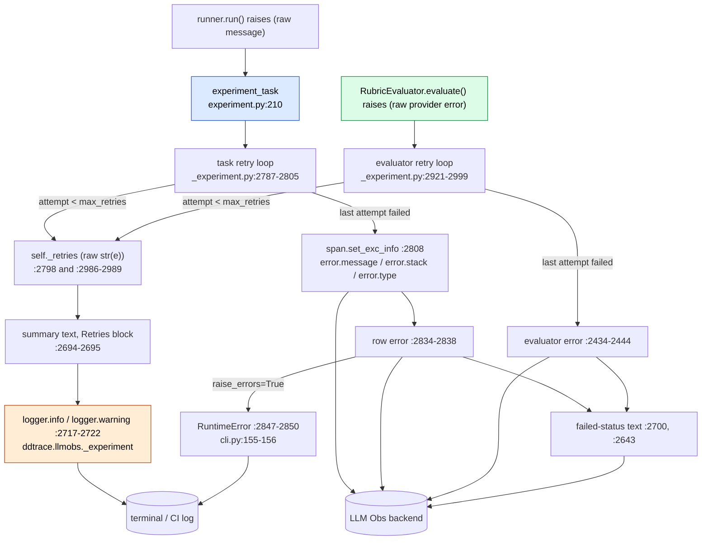

# Raw error text in the ddtrace experiment retry summary (ROMAIN-65, O7)

Status: decided. Romain selected **C** (ROMAIN-65, Nov 19). Size: Small. Code:
`src/airedale/experiment.py`, `src/airedale/scoring/rubric.py`, tests, `AGENTS.md`,
`README.md`. No ddtrace change.

All `_experiment.py` line numbers are for `ddtrace/llmobs/_experiment.py`. They are the
same in ddtrace 4.16.3 and 4.17.0 (see [Constraints](#4-constraints)).

## Decision

Romain selected **C**, the recommendation. The table compares the six experiment sinks of
[§1](#1-scope-finding). Child spans are not in these sinks (see
[Child spans](#child-spans-are-outside-the-guard)).

| | A. Log filter | B. Safe task error | **C. Safe task and judge errors** |
|---|---|---|---|
| Change | A filter on the logger `ddtrace.llmobs._experiment` replaces the `Retries (N):` block | `experiment_task` raises a new error with the `exception_summary(e)` text | B, plus the same guard in `RubricEvaluator.evaluate` |
| Summary log line, task retries | Hidden | Safe text | Safe text |
| Summary log line, judge retries | Hidden | **Raw** | Safe text |
| Experiment span tags, row error, failed-status text (LLM Obs) | **Raw** | Safe text | Safe text |
| Judge eval error, message and stack (LLM Obs) | **Raw** | **Raw** | Safe text |
| `--fail-fast` console line (`cli.py:155-156`) | **Raw** | Safe text | Safe text |
| Debug text that the experiment records keep | All | Task: type, place, frames. Judge: all | Task and judge: type, place, frames |
| Depends on the text format of the ddtrace summary | Yes | No | No |
| Meets the definition of done | Yes | **No** (judge retries stay raw) | Yes |
| DD-35 step 8 test | Can keep the hand-set `_retries` | Must run a real retry | Must run a real retry |

"Safe text" is the output of `exception_summary`, for example `ValueError at pi_spans.py:512`:
the type names and the innermost place. It has no message.

Rejected:

- **A + C.** Two mechanisms for one risk. A depends on the ddtrace text format, and C already
  covers each code path that writes to `_retries`.
- **`raise ... from None`** (the first proposal). `from None` sets only `__suppress_context__`.
  The raw error stays in `__context__`. ddtrace 4.16.3 obeys `__suppress_context__`
  (`traceback.print_exception` in `span.py`, `debugging/_exception/replay.py:129-134`), but a
  different reader can ignore it. Airedale code raises outside the handler instead
  (`gateway.py:116-119`, `scoring/decisions.py:112-113`). C does the same.

## 1. Scope finding

The issue names one sink: the summary log line. In ddtrace, the raw `str(e)` goes to six sinks:

1. **Retry list** `self._retries`, from the task loop (`:2798`) **and** from the evaluator loop
   (`:2986-2989`). The summary log line prints the list (`:2694-2695`, `:2717-2722`).
2. **Task span error tags** `error.message`, `error.stack`, `error.type` (`span.set_exc_info`,
   `:2808`). `error.stack` also holds the message of each chained exception.
3. **Row error** of the experiment record (`:2834-2838`), a copy of the span tags. It goes to the
   LLM Obs backend.
4. **Failed-status text** of the experiment (`_build_error_summary`, `:2700`), sent by
   `_update_status("failed", ...)` (`:2643`).
5. **Evaluator error** (`_build_evaluator_error`, `:2434-2444`): message and full stack. It goes
   to the backend with the eval metric (`:3100`).
6. **Fail-fast error.** With `raise_errors=True` (airedale `--fail-fast`),
   `_check_task_result_error` (`:2847-2850`) raises a `RuntimeError` with the row message and
   stack. `cli.py:155-156` prints it.

Sink 1 needs `max_retries > 0`. Sinks 2 to 6 occur **today**, with `max_retries=0`.

### Child spans are outside the guard

The six sinks are the experiment records: the experiment span, the row, the evaluator error,
the status text, the summary log line and the fail-fast error. Child spans that are
instrumented on their own record the original error **before** `experiment_task` gets it:

- The `@agent` span of `DecoratorSpanAgentRunner` (Codex, pi): `run` raises
  `run_result.error` inside the span (`harness/base.py:711-712`). The ddtrace decorator runs the
  function in a `with` span block (`ddtrace/llmobs/decorators.py:241-264`), and the span records
  the error when the block exits. The pi errors are fixed
  texts already (`AGENTS.md`, option S). The Codex errors are not checked.
- The native ddtrace Claude spans (accepted raw output of DD-35, `AGENTS.md` "Claude failed
  runs").

The C guards do not change these spans. They are out of scope (see [§8](#8-out-of-scope)).



Guard points: blue = B and C, green = C only, orange = A.

### Which code raises raw text

- **Task:** any runner error. Example: the Claude runner error holds the CLI result text
  (DD-35 O5, accepted for the raised error).
- **Judge:** `RubricEvaluator.evaluate` (`scoring/rubric.py:125`) does not catch provider
  errors. An Anthropic or OpenAI SDK error holds the HTTP response body.
- **A cancellation with a raw chain (plan amendment v2):** a plain `CancelledError` is not an
  `Exception`, so the first guard version let it pass. It can hold the raw error in
  `__context__` when 1 Ctrl+C arrives during an `await` in a `finally` or `__aexit__` while a raw
  run error is in flight (for example the `git worktree remove` of `WorkspaceManager.workspace`,
  `workdir.py:132-136`). ddtrace prints that chain in the span `error.stack`. It is reachable
  with 1 Ctrl+C.
- **A mixed `BaseExceptionGroup`:** a group of an ordinary error and a cancellation (or a
  `KeyboardInterrupt`) is not an `Exception` either. No airedale code, Claude SDK or judge SDK
  path makes one today. The mcp SDK (anyio task groups) in the metadata probe of
  `DecoratorSpanAgentRunner` could, after a second Ctrl+C. It is theoretical, but the guard must
  not leak its message, leaves and notes.
- **Judge, safe today:** `DecisionsRubricEvaluator._request` raises a fixed text outside the
  handler (`scoring/decisions.py:100-113`). C does not change it.

### Debug information that the experiment records lose

The first three rows apply to B and C. The last row applies to C only.

| Field | Today | With C |
|---|---|---|
| `error.message` (experiment span, row, status text) | Raw message | `<Type> at <file>:<line>` |
| `error.type` | Original class, for example `claude_agent_sdk._errors.ProcessError` | The wrapper class. The original class name stays in the message, without its module. |
| `error.stack` | Frames, the message, each chained exception and its message | The original frames only. No message, no chained exception. |
| Judge eval error | Provider message (status, body) | `<Type> at <file>:<line>`. The SDK class name (for example `RateLimitError`) stays. With B: no change (raw). |

Safe fixed texts are lost too. Example: the pi errors (`pi exited with status N for <model>`)
and the path of the private report `pi-run-*.log`. The report files stay in the output
directory. The path of the Claude private report stays in its log line (DD-35). For an error
without a private report (for example a judge error), no copy of the message stays in the
experiment records. A child span can still have a copy (see
[Child spans](#child-spans-are-outside-the-guard)).

## 2. Design (option C)

### Task guard: `experiment_task` (`src/airedale/experiment.py:210-222`)

```python
class ExperimentTaskError(RuntimeError):
    """A task error with a safe message: type names and place, no raw text."""


async def experiment_task(input_data, config=None):
    try:
        return await _run_task_body(input_data)  # The current body, not changed.
    except BaseException as error:  # Never swallowed: safe_error keeps the shape of a cancellation.
        safe = safe_error(error, ExperimentTaskError)
    # Raise outside the handler, so __context__ and __cause__ are None.
    raise safe
```

Rules (`safe_error` in `src/airedale/safe_log.py`, plan amendment v2: G1 = A, G2 = in):

1. An `Exception` (also an `ExceptionGroup`) becomes `ExperimentTaskError(exception_summary(error))`,
   with the frames of the original error. It stays an `Exception`, so the retry and
   `--fail-fast` do not change.
   A `BaseExceptionGroup` that is not an `Exception` (it has a `CancelledError`,
   `KeyboardInterrupt` or `SystemExit` leaf) is rebuilt with the same shape: a new group with the
   `exception_summary` text and the original frames. Each leaf follows these rules. The
   cancellation leaf stays, so the group is still not an `Exception` and ddtrace still does not
   retry it.
   Any other `BaseException` (`CancelledError`, `KeyboardInterrupt`, `SystemExit`) is **the same
   object**, with the same type and message. Only its raw chain is cut: `__cause__`, `__notes__`
   and a `__context__` that is not a `CancelledError`. A `CancelledError` context stays (and is
   made safe in the same way), because anyio finds its own cancellations by the message of the
   error and of its context. The message text of a cancellation error is out of scope: only code
   writes it (anyio, asyncio, the SIGINT handler), never a runner, a provider or the model.
2. Raise outside the `except` block (see "Rejected" above).
   The guard also calls `safe_error` outside the `except` block (it only keeps the caught error in
   a variable inside it). If the helper failed inside the handler, Python would attach the raw
   error as `__context__` of the new error. `safe_error`, `exception_summary` and the cleanup of
   cancellation contexts use loops, not recursion: a chain or a group of 1,500+ levels would
   otherwise raise a `RecursionError` that holds the raw error.
3. Keep the frames (`with_traceback`). `error.stack` then keeps the file, line, function and
   source line of each frame. It has no message and no local value. A source line is the code
   text from the file, not a value of the run. Without this call, `error.stack` shows only the
   ddtrace frame and `experiment_task`.

### Judge guard: `RubricEvaluator.evaluate` (`src/airedale/scoring/rubric.py:125-154`)

The same pattern, with its own class (for example `RubricJudgeError(RuntimeError)`).

### No change

- `max_retries` stays 0 (`experiment.py:272`). No config key, no CLI flag.
- The error that the Claude runner raises (O5) does not change. Only the copy that ddtrace
  gets changes.
- No change to ddtrace or to its logger.

## 3. Answers to the open questions

1. **Effect on `raise_errors=fail_fast`: no change in behavior.** The task loop catches each
   task `Exception`, also with `raise_errors=True` (`:2795`). After the last attempt,
   `_check_task_result_error` raises only when `error.message` is not empty (`:2847`).
   `exception_summary` always has a type name, so it is never empty. `--fail-fast` still stops
   the run. The console line becomes `error: Error on record 0: ValueError at x.py:12`, then the
   type and the frames, with no raw text.
2. **Effect on the judge path: B does not cover it.** When the task fails, ddtrace still calls
   the evaluators, with `output_data=None` (`:3079-3093`). B does not change this. But the
   evaluator loop writes its own raw `{e}` to the same `_retries` list (`:2986-2989`). With B, a
   failed `RubricEvaluator` attempt puts raw text in the summary line. This is why C adds the
   judge guard. For a judge with `raise_errors=True`, ddtrace raises
   `RuntimeError("Evaluator <name> failed on row <idx>") from e` (`:2999`). The console line is a
   fixed text, and with C the chained `e` is safe.
3. **Effect on the retry behavior: no change.** The wrapper is an `Exception` subclass, so the
   loop catches it (`:2795`) and tries again. The attempt count, the delay, the semaphore and
   the span tag `retries` (`:2804-2805`) do not change. Each attempt still opens a new workspace
   (`experiment.py:212`). The retry line becomes
   `task row 0: attempt 1/2 failed: ValueError at x.py:12`.
4. **Does ddtrace `get_logger` redact or rate-limit? It rate-limits. It does not redact.**
   `get_logger` (`ddtrace/internal/logger.py:96-113`) adds `log_filter` (`:165-215`) to the
   logger. `log_filter` does two things:
   - **Rate limit:** 1 record for each key every 60 seconds (`DD_TRACE_LOGGING_RATE`, `0` = no
     limit). The summary has `product="llmobs"`, so the key is the full message text (`:182`).
     There is no limit when the effective level of the logger is DEBUG (`:176`).
   - **Format:** `record.msg` becomes `llmobs::<summary>` (`:204`).

   Effect: the rate limit gives no protection, because the first summary is always logged. In a
   test, the rate limit can drop a record, and an "is absent" assert then passes for the wrong
   reason. So each test sets the logger to DEBUG and asserts that the summary record exists.

## 4. Constraints

1. **Start from `main` after PR #64 merges** (Romain, Q2 = A). Do not stack on the PR #64
   branch.
2. **Correction to the findings:** `exception_summary` was **already on `main`** before PR #64
   (`src/airedale/safe_log.py:27`, from PR #51). After PR #64 it is at `safe_log.py:29`. So the
   production code does not need PR #64. The test needs it:
   `test_the_ddtrace_retry_summary_is_not_changed` (`tests/test_harness_claude.py:315-329`) and
   its fixtures (`_FakeTransport`, `_claude_runner`, `RETRY_MARKER`) are only in PR #64.
   C does not use `_hidden_message`.
3. **ddtrace 4.16.3 and 4.17.0 are identical here.** `ddtrace/llmobs/_experiment.py` and
   `ddtrace/internal/logger.py` are byte-identical in the two tags (PR #68 bumps 4.16.3 to
   4.17.0). `ddtrace/_trace/span.py` changes, but `_get_traceback` and `set_exc_info` are
   identical (4.16.3 `:359-443`, 4.17.0 `:293-377`). If `main` pins a different version when the
   work starts, check these files again.
4. **No ddtrace option** turns off or redacts the summary. No upstream issue or PR was found.
5. **Unit tests run offline** (`AGENTS.md` §8). No real LLM Obs call and no real provider call.

## 5. Acceptance criteria

Tags: `[integration test]` = an offline test that runs the real ddtrace `Experiment` code
(retry loop, span, row, summary log) with a fake LLM Obs service (`_llmobs_instance=`).
`[unit test]`, `[review]` and `[CI]` have their usual meaning.

Rule for each test: set the logger `ddtrace.llmobs._experiment` to DEBUG
(`caplog.set_level(logging.DEBUG, logger="ddtrace.llmobs._experiment")`) and assert that the
summary record exists before you assert that a marker is absent. Raise the marker from a
variable, not from a literal in the `raise` line: `error.stack` keeps source lines, so a literal
in that line makes the test fail for the wrong reason.

1. `[integration test]` **DD-35 step 8 test, changed** (`tests/test_harness_claude.py:315-329`).
   - Rename it (for example `test_the_ddtrace_retry_summary_has_no_raw_text`). Change the
     docstring from "O7 (accepted)" to "O7".
   - Remove the hand-set `experiment._retries` and the direct `_log_experiment_summary` call.
   - Run a **real retry**: airedale `experiment_task` from `_run_cell`, a failed Claude run
     (`_FakeTransport`, both paths), and ddtrace `Experiment.run(max_retries=1,
     retry_delay=lambda _: 0)`.
   - Lines 327-329 change from "the marker is in a record" to: (a) a `ddtrace.llmobs._experiment`
     record contains `Retries (1)`, and (b) no record (`getMessage()` and `exc_text`) contains
     `READER_MARKER`, `RESULT_MARKER` or `STDERR_MARKER`. Remove `RETRY_MARKER` if no test uses it.
2. `[integration test]` **Task sinks.** A runner raises `ValueError(MARKER)` on each attempt,
   `max_retries=1`. The marker is not in the row `error.message`, `error.stack` or `error.type`,
   and not in `_build_error_summary(result)`. `error.message` matches
   `ValueError at <file>:<line>`. `error.stack` contains the runner frame (frames are kept).
3. `[integration test]` **Retry still works.** A runner fails on attempt 1 and passes on
   attempt 2. The runner was called 2 times. The row has no error and has the output of
   attempt 2. The span tag `retries` is `"1"`. The retry line has no marker.
4. `[integration test]` **`--fail-fast`.** The runner of item 2, with `raise_errors=True`.
   `run()` raises a `RuntimeError` that starts with `Error on record 0: ValueError at`. The
   marker is not in `"".join(traceback.format_exception(error))`.
5. `[integration test]` **Judge path.** `RubricEvaluator` with a fake provider (httpx
   `MockTransport`, an error response with the marker in the body) and the real
   `Experiment._evaluate_record(..., max_retries=1, retry_delay=lambda _: 0)`. The summary record
   contains `Retries (1)` and no marker. The eval `error.message` and `error.stack` have no
   marker.
6. `[unit test]` **Wrapper rules.** For the task guard and the judge guard: the raised error
   has `__cause__ is None` and `__context__ is None`. An `asyncio.CancelledError` passes as the
   same object, with the same message, and with its raw `__context__`, `__cause__` and notes cut.
7. `[review]` `src/airedale/experiment.py:272` does not pass `max_retries` (the default 0
   stays). There is no new config key and no new CLI flag.
8. `[review]` `AGENTS.md` §8 has one new bullet: task and judge errors reach ddtrace as
   `exception_summary` text, what the experiment records lose, where the private reports are,
   and that child spans are not covered. The "Accepted raw outputs" of the "Claude failed
   runs" bullet and the "Claude runs" item of `README.md` no longer list the experiment span,
   the status, the retry summary and the `cli.py` line.
9. `[CI]` `uv run ruff format --check .`, `uv run ruff check --no-fix .`, `uv run pyright` and
   `uv run pytest` pass.

10. `[manual check]` The mutation check fails as expected: with the 2 guards replaced by a
    bare pass-through, the task and judge tests fail on a marker assert.
11. `[integration test]` A mixed `BaseExceptionGroup` gives safe text for the task and the judge,
    and the cancellation leaf stays (no retry, `--fail-fast` still raises a group). Check:
    `test_a_mixed_group_task_error_reaches_ddtrace_as_safe_text`,
    `test_a_mixed_group_judge_error_reaches_ddtrace_as_safe_text`.
12. `[integration test]` A real cancellation (`task.cancel()` during the cleanup of a failed
    run) keeps propagating (the "interrupted" status and the WARNING summary), as the same
    object with the same message, without its raw chain. Check:
    `test_a_cancellation_keeps_propagating_without_its_raw_chain`, and the extended
    `test_the_guards_do_not_chain_or_wrap_cancellation`.
13. `[unit test]` The `safe_error` rules (nested groups, notes, the anyio context, cycles,
    `SystemExit`, `KeyboardInterrupt`). Check: `tests/test_safe_log.py::test_safe_error_*`.
    The mutation check of item 10 extends to the guard of `BaseException`: with its body replaced
    by a bare `raise`, the tests of items 11 and 12 fail on a marker assert.

## 6. Review requirements

The change is on a security boundary (raw data to logs, spans and the backend) and on an
external integration (ddtrace internals). Use the `code-review` process: 4 read-only reviewers in
parallel, each on a tier 4 or 5 model from a different foundry than the implementer, with high
thinking.

| Reviewer | Why | Questions |
|---|---|---|
| Security and trust boundaries | Data exposure is the purpose of the change | Does any sink in the diagram still get raw text? Check `__context__`, `__notes__`, exception groups, frames and source lines. |
| Correctness and runtime behavior | The guard is on the retry, fail-fast and interrupt paths | Do retries, `--fail-fast`, the interrupt (WARNING summary) and the workspace cleanup work as before? |
| API and compatibility | The design depends on ddtrace internals and changes `error.type` in LLM Obs | Are the ddtrace facts true for the version that `main` pins? Does a dashboard or monitor use `error.type`? Is the `AGENTS.md` bullet correct? |
| Tests and validation | An "is absent" assert can pass for the wrong reason | Do the tests use the real retry loop? Do they assert that the record exists? Is the DD-35 step 8 change correct? |

After that, the squad Adversarial Reviewer challenges the result against the scope that Romain
selected (C, with the debug loss and without the child spans).

## 7. Risks

| Risk | How the design reduces it |
|---|---|
| The wrapper is not an `Exception` subclass, so no retry occurs | `RuntimeError` subclass. Item 3. |
| An empty message, so `--fail-fast` does not stop the run | `exception_summary` is never empty. Item 4. |
| The guard swallows or wraps a cancellation, so the interrupt fails | `safe_error` keeps the same object for a cancellation and the cancellation leaf of a group, and the guard raises it again. Items 6 and 12. |
| The new cancellation object has no message, so anyio does not find its own cancellation | The same object is kept, with its message, and a `CancelledError` context stays. Item 13. |
| A new ddtrace version adds a sink (for example `exc_info` on the summary) | The tests run the real ddtrace code and check each record and the row error. Items 1 to 5. |
| The rate limit drops the record, so a test passes for the wrong reason | DEBUG level and a "record exists" assert in each test. |
| LLM Obs has less debug text | The frames stay. The private reports of pi and Claude stay. Romain accepted the loss (C). |

## 8. Out of scope

- DD-64 (O6): the progress and console output of the runners.
- Child spans that are instrumented on their own: the `@agent` span of
  `DecoratorSpanAgentRunner` and the native ddtrace Claude spans (see
  [Child spans](#child-spans-are-outside-the-guard)). A possible follow-up issue.
- DD-35 O5: the error that the Claude runner raises.
- The message text of a cancellation error (`CancelledError`, `KeyboardInterrupt`): code writes
  it (anyio, asyncio, the SIGINT handler), not a runner, a provider or the model.
- A `max_retries` option in airedale.
- Keep safe fixed texts (pi errors, report paths) in LLM Obs. A possible follow-up: an
  allow-list of airedale error classes that have fixed messages.
- ddtrace Exception Replay (`DD_EXCEPTION_REPLAY_ENABLED`). It records local values of frames.
  No option here changes this.
- An upstream ddtrace option to redact the summary.

## Estimate

Option C: about 3 hours. 30 minutes for the two guards, 2 hours for the tests (most of it is the
fake LLM Obs service), 15 minutes for `AGENTS.md`, 15 minutes for the CI result. Review: about
1 hour for 1 round. Option A: about 1.5 hours.
